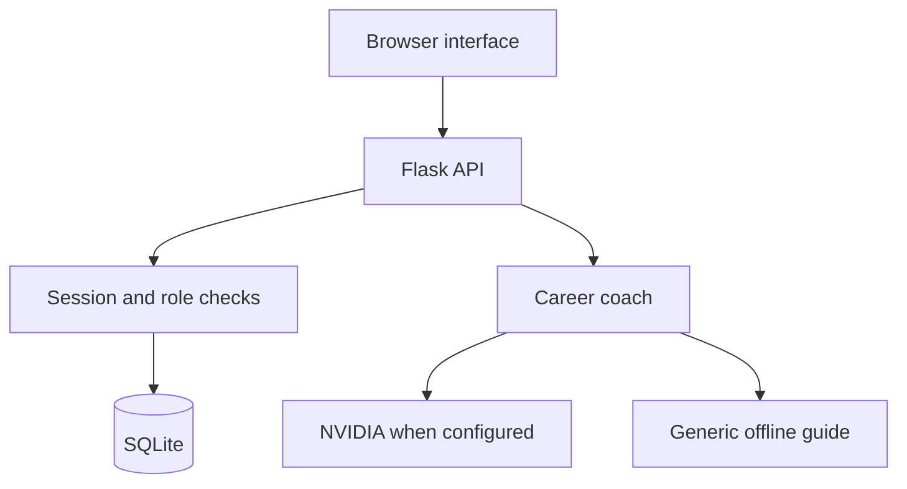
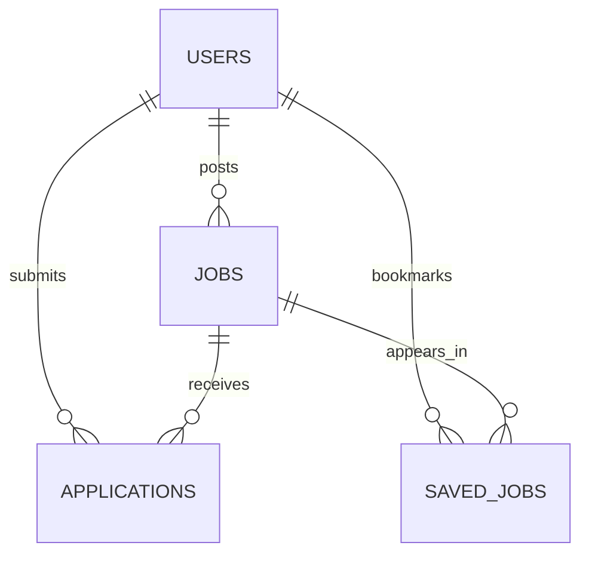

# CareerBridge — Project report and viva notes

## Abstract
CareerBridge organizes entry-level hiring in a single portal. Students search and save roles, send applications, and track progress. Recruiters publish jobs and review candidates. A career toolkit offers generic offline guidance and optional NVIDIA AI assistance.

## Problem and objectives
Unstructured job messages make applications difficult to track. The project provides searchable opportunities, separate role-based workspaces, persistent applications, recruiter-controlled status, and preparation support. It demonstrates web APIs, relational modelling, authorization, and external API error handling.

## Architecture

The frontend uses hash navigation and fetch requests. Flask serves assets and JSON from one origin. Signed cookies identify users; protected endpoints load the stored account and role. SQL uses placeholders. External model calls happen only on the server.

## Data model

| Table | Important fields | Constraints |
|---|---|---|
| users | id, name, email, password_hash, role | Unique email; student/recruiter |
| jobs | id, recruiter_id, title, company, location, kind, salary, skills, description, status | User FK; open/closed |
| applications | id, job_id, student_id, resume, cover_letter, status, created_at | Unique job/student pair; FKs |
| saved_jobs | student_id, job_id | Composite primary key; FKs |

## Workflow
A visitor searches open roles. A student signs in and applies; validation checks the role, open status, and uniqueness. Recruiters see applicants only for jobs they own and change status. The student's dashboard retrieves the updated record. Coaching returns a labelled guide or invokes the configured provider.

## Security
Werkzeug hashes passwords. Parameterized SQL protects query values. Session-bound CSRF tokens protect mutations. Ownership conditions restrict recruiter updates. The frontend escapes user text before HTML rendering. Cookies are HttpOnly/SameSite=Lax, and responses include CSP and anti-framing headers. Input sizes are bounded.

This is an educational MVP. Public use requires verification, rate limiting, recruiter vetting, privacy/retention controls, HTTPS, monitoring, and backups.

## Testing
Integration tests use temporary SQLite databases and Flask test clients. They exercise search, authentication, CSRF, roles, application updates, duplicate prevention, bookmarks, ownership, persistence, and provider errors. See TEST_RESULTS.md for executed results and verification limits.

## Differences from reference
CareerConnect uses FastAPI and MongoDB Atlas. CareerBridge uses Flask and SQLite for simpler local setup, with an independent UI, recruiter dashboard, bookmarks, and explicit offline guidance. No reference source files were copied.

## Limitations and future scope
No resume file uploads, password reset, verification, application withdrawal, notifications, pagination, admin moderation, or live vacancies. Future work can add these features and deploy on a Python server with persistent storage. AI output is guidance, not a prediction or hiring guarantee.

## Viva questions
- **Why SQLite?** Relational integrity and persistence without a separate server, suitable for a local demonstration.
- **Authentication versus authorization?** Who the user is versus which actions/records they may access.
- **Why hash passwords?** Store a one-way verifier instead of plaintext credentials.
- **Why CSRF tokens?** Browsers automatically attach cookies; a session-bound token prevents unwanted cross-site mutations.
- **How are duplicates stopped?** A UNIQUE(job_id, student_id) constraint and a friendly 409 response.
- **How is ownership checked?** Queries restrict changes to the authenticated recruiter's job IDs.
- **What happens without AI credentials?** A clearly labelled generic template, not personalized analysis.
- **Can GitHub Pages run it?** No; the backend requires Python and persistent SQLite storage.

## References
- Concept: https://github.com/mxstafa520/CareerConnect
- Flask: https://flask.palletsprojects.com/en/stable/
- SQLite: https://www.sqlite.org/docs.html
- NVIDIA: https://docs.api.nvidia.com/
- GitHub Pages: https://docs.github.com/en/pages/getting-started-with-github-pages/what-is-github-pages
